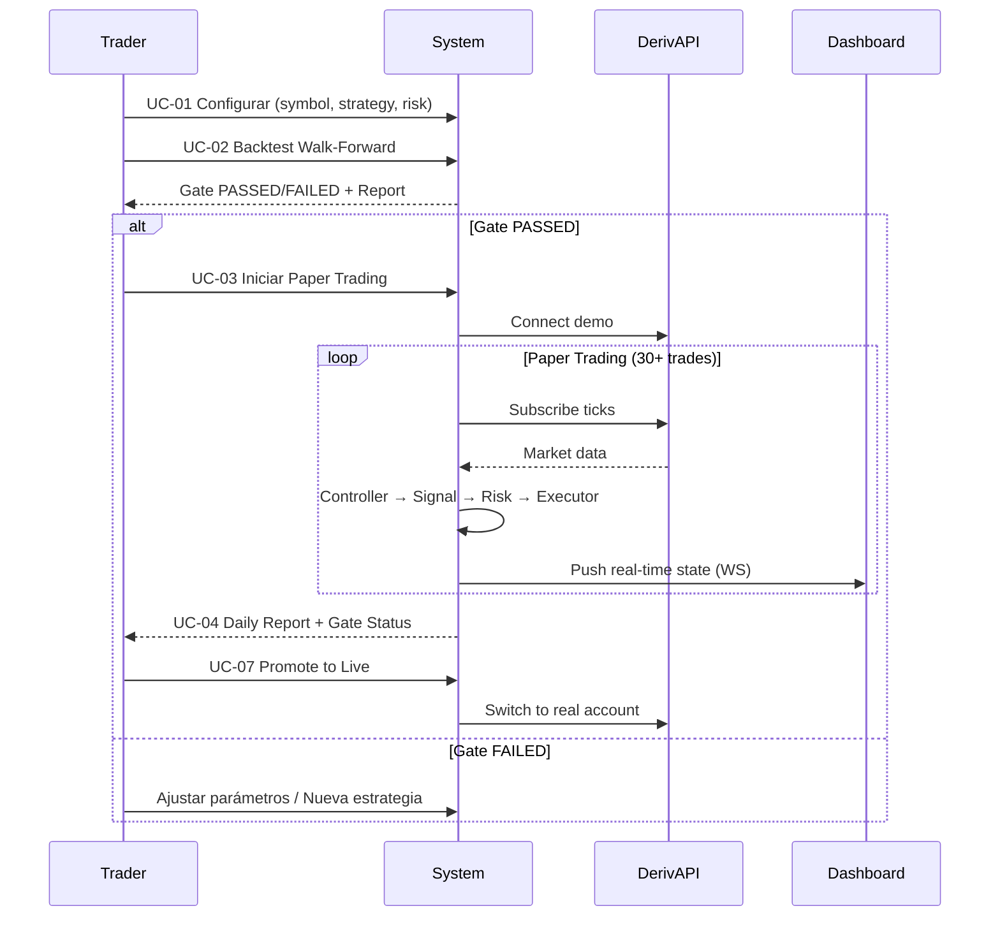

# Synthetic Trader — Master Refactoring Plan

**Versión:** 1.0  
**Fecha:** 2026-08-19  
**Estado:** Draft para revisión

---

## 1. Resumen Ejecutivo

El proyecto actual tiene **dos arquitecturas paralelas** que no se comunican:
- **Legacy** (`src/main.py`, `src/trading/paper_runner.py`, `src/strategies/`) — funcional pero monolítico
- **New Controller-Executor** (`src/trading/engine.py`, `src/trading/controllers.py`, `src/trading/executors.py`) — modular pero no integrado

El dashboard lee archivos JSONL del filesystem en lugar de consumir eventos del message bus. El API server es un facade que no conoce la nueva arquitectura.

---

## 2. Análisis de Gaps y Bugs Críticos

### 2.1 Arquitectura Dual (CRÍTICO)

| Componente | Legacy | New | Estado |
|------------|--------|-----|--------|
| Entry point | `src/main.py` | `src/trading/engine.py` | **Duplicados** |
| Strategies | `src/strategies/*.py` (base `Strategy`) | `src/trading/strategy_factory.py` (wrapper) | **Dos jerarquías** |
| Paper trading | `paper_runner.py` | `executors.py` (PaperExecutor) | **Duplicados** |
| Risk | `src/risk/manager.py` + `circuit_breaker.py` | `src/trading/risk_engine.py` | **Duplicados** |
| Portfolio | N/A | `src/trading/portfolio.py` | **Solo new** |
| Message Bus | N/A | `src/trading/message_bus.py` | **Solo new** |

### 2.2 Frontend Bugs

| Bug | Severidad | Archivo |
|-----|-----------|---------|
| API base URL hardcoded a `localhost:8001` | Alta | `dashboard/src/lib/api.ts:9` |
| Dashboard corre en puerto 3030, API en 8001 — CORS OK pero confuso | Media | Config |
| Polling 15s en lugar de WebSocket | Alta | `dashboard/src/hooks/use-live-data.ts` |
| Allocator page: formulario no funcional, hardcoded defaults | Media | `dashboard/src/app/allocator/page.tsx:42-53` |
| No error boundaries en React | Media | `dashboard/src/app/layout.tsx` |
| Types `any` en todos los componentes | Baja | Múltiples |

### 2.3 Backend Gaps

| Gap | Descripción |
|-----|-------------|
| No unified config | Config散落在: `.env`, `config/`, `EngineConfig`, `RiskConfig`, `ControllerConfig` |
| No DI container | Instanciación manual en todas partes |
| API server desconectado de TradingEngine | Lee archivos, no suscribe eventos |
| No CQRS real | Message bus existe pero comandos/queries no separados |
| No event sourcing | Estado guardado en JSONL, no event store |
| No multi-symbol / multi-strategy | Engine hardcoded a 1 symbol/strategy |
| No backtest-to-live pipeline automatizado | Pasos manuales entre fases |

---

## 3. Modelos de Caso de Uso (Use Case Models)

### 3.1 Actores Principales

```mermaid
actor Trader as "Trader Humano"
actor System as "Sistema Automatizado"
actor Dashboard as "Dashboard UI"
actor DerivAPI as "Deriv API"
actor BacktestEngine as "Backtest Engine"
```

### 3.2 Casos de Uso Core

| UC-ID | Caso de Uso | Actor Primario | Descripción |
|-------|-------------|----------------|-------------|
| UC-01 | **Configurar Pipeline de Trading** | Trader | Definir símbolo, estrategia, risk params, capital |
| UC-02 | **Ejecutar Backtest Walk-Forward** | Trader | Correr backtest con validación estadística (gate) |
| UC-03 | **Iniciar Paper Trading** | Trader | Desplegar estrategia validada en demo account |
| UC-04 | **Monitorear Trading en Tiempo Real** | Trader/Dashboard | Ver P&L, posiciones, risk metrics, equity curve |
| UC-05 | **Gestión de Capital (Allocator)** | Trader | Configurar reserva/superávit, reinversión, stake sizing |
| UC-06 | **Circuit Breaker & Risk Control** | System | Auto-halt en drawdown diario / pérdidas consecutivas |
| UC-07 | **Transición Paper → Live** | Trader | Promover estrategia tras pasar gates de paper |
| UC-08 | **Atribución de Rendimiento** | Trader | Analizar P&L por estrategia/símbolo/regime |
| UC-09 | **Gestión de Configuración** | Trader | CRUD de parámetros sin redeploy |
| UC-10 | **Health & Observability** | System/Dashboard | Logs, métricas, alertas, uptime |

### 3.3 Flujo Principal (Happy Path)



---

## 4. Patrones de Diseño Aplicados

### 4.1 Patrones Arquitectónicos

| Patrón | Aplicación | Ubicación |
|--------|------------|-----------|
| **Controller-Executor** | Separar decisión (signal) de ejecución (order) | `src/trading/controllers.py` + `executors.py` |
| **Message Bus / Event-Driven** | Comunicación async entre componentes | `src/trading/message_bus.py` |
| **CQRS** | Commands (orders) vs Queries (dashboard) | API endpoints vs Message Bus events |
| **Event Sourcing** | Estado derivado de secuencia de eventos | `equity.jsonl`, `positions.json` → migrar a event store |
| **Strategy Pattern** | Estrategias intercambiables | `src/trading/strategy_factory.py` |
| **Factory Pattern** | Instanciación de estrategias/controllers/executors | `create_strategy`, `create_controller`, `create_executor` |
| **Template Method** | Pipeline fijo: Data → Signal → Validate → Execute | `BaseController.on_candle_closed` |
| **Decorator** | Risk checks composable | `RiskEngine.validate_order` con lista de checks |
| **Observer** | Dashboard subscribe a eventos | `message_bus.subscribe` |
| **Circuit Breaker** | Auto-halt en condiciones adversas | `src/risk/circuit_breaker.py` + `RiskEngine` |

### 4.2 Patrones de Dominio (Domain Patterns)

| Patrón | Aplicación |
|--------|------------|
| **Aggregate Root** | `Portfolio` agrega `Position`, `Equity` |
| **Value Object** | `Signal`, `Order`, `Price`, `Stake`, `RiskCheck` |
| **Domain Event** | `SignalGenerated`, `OrderValidated`, `OrderFilled`, `PositionClosed` |
| **Repository** | `BacktestRepository`, `TradeRepository` (persistencia) |
| **Specification** | `RiskCheck` como specification pattern |
| **Policy** | `AllocationPolicy`, `RiskPolicy`, `SizingPolicy` |

### 4.3 Patrones de Integración

| Patrón | Aplicación |
|--------|------------|
| **Adapter** | `DerivClient` adapta API Deriv → dominio |
| **Gateway** | `DataCollector` para datos históricos |
| **Anti-Corruption Layer** | Entre legacy strategies y new controller |

---

## 5. Arquitectura Objetivo (Target Architecture)

```
┌─────────────────────────────────────────────────────────────────────────────┐
│                              PRESENTATION LAYER                             │
│  ┌─────────────┐  ┌─────────────┐  ┌─────────────┐  ┌─────────────────┐   │
│  │  Dashboard  │  │   Mobile    │  │   CLI/REPL  │  │  External API   │   │
│  │  (Next.js)  │  │  (Future)   │  │  (Future)   │  │  (Webhooks)     │   │
│  └──────┬──────┘  └──────┬──────┘  └──────┬──────┘  └────────┬────────┘   │
└─────────┼────────────────┼────────────────┼─────────────────┼────────────┘
          │                │                │                 │
          ▼                ▼                ▼                 ▼
┌─────────────────────────────────────────────────────────────────────────────┐
│                            API GATEWAY (FastAPI)                            │
│  ┌─────────────┐  ┌─────────────┐  ┌─────────────┐  ┌─────────────────┐   │
│  │ REST API    │  │ WebSocket   │  │ GraphQL     │  │ Auth/RateLimit  │   │
│  │ (Queries)   │  │ (Real-time) │  │ (Flexible)  │  │ (Security)      │   │
│  └──────┬──────┘  └──────┬──────┘  └──────┬──────┘  └────────┬────────┘   │
└─────────┼────────────────┼────────────────┼─────────────────┼────────────┘
          │                │                │                 │
          ▼                ▼                ▼                 ▼
┌─────────────────────────────────────────────────────────────────────────────┐
│                          APPLICATION LAYER (Use Cases)                      │
│  ┌─────────────┐  ┌─────────────┐  ┌─────────────┐  ┌─────────────────┐   │
│  │ Trading     │  │ Backtest    │  │ Capital     │  │ Risk            │   │
│  │ Use Cases   │  │ Use Cases   │  │ Use Cases   │  │ Use Cases       │   │
│  └──────┬──────┘  └──────┬──────┘  └──────┬──────┘  └────────┬────────┘   │
└─────────┼────────────────┼────────────────┼─────────────────┼────────────┘
          │                │                │                 │
          ▼                ▼                ▼                 ▼
┌─────────────────────────────────────────────────────────────────────────────┐
│                           DOMAIN LAYER (Core)                               │
│  ┌─────────────┐  ┌─────────────┐  ┌─────────────┐  ┌─────────────────┐   │
│  │ Trading     │  │ Strategy    │  │ Risk        │  │ Portfolio       │   │
│  │ Engine      │  │ Registry    │  │ Engine      │  │ Aggregate       │   │
│  │ (Orchestrator)              │  │ (Validation)  │  │ (State)         │   │
│  └──────┬──────┘  └──────┬──────┘  └──────┬──────┘  └────────┬────────┘   │
└─────────┼────────────────┼────────────────┼─────────────────┼────────────┘
          │                │                │                 │
          ▼                ▼                ▼                 ▼
┌─────────────────────────────────────────────────────────────────────────────┐
│                        INFRASTRUCTURE LAYER                                 │
│  ┌─────────────┐  ┌─────────────┐  ┌─────────────┐  ┌─────────────────┐   │
│  │ Deriv       │  │ Data        │  │ Persistence │  │ Message Bus     │   │
│  │ Gateway     │  │ Provider    │  │ (PostgreSQL/  │  │ (Redis/NATS)    │   │
│  │ (WebSocket) │  │ (Parquet)   │  │  EventStore) │  │                 │   │
│  └─────────────┘  └─────────────┘  └─────────────┘  └─────────────────┘   │
└─────────────────────────────────────────────────────────────────────────────┘
```

---

## 6. Matriz de Trazabilidad (Traceability Matrix)

### 6.1 Requisitos → Componentes

| Requisito | UC | Componentes Afectados | Tests | Docs |
|-----------|----|----------------------|-------|------|
| R-01: Multi-strategy support | UC-01, UC-03 | `TradingEngine`, `StrategyRegistry`, `ControllerFactory` | `test_multi_strategy.py` | `ARCHITECTURE.md` |
| R-02: Walk-forward backtest gate | UC-02 | `BacktestEngine`, `WalkForwardValidator`, `GateEvaluator` | `test_walk_forward.py` | `BACKTEST_GUIDE.md` |
| R-03: Real-time paper trading | UC-03, UC-04 | `TradingEngine`, `PaperExecutor`, `MessageBus`, `WebSocket` | `test_paper_trading.py` | `PAPER_TRADING.md` |
| R-04: Risk management (3%/trade, 5%/day) | UC-06 | `RiskEngine`, `CircuitBreaker`, `CapitalAllocator` | `test_risk_engine.py` | `RISK_MANAGEMENT.md` |
| R-05: Dynamic position sizing | UC-05 | `CapitalAllocator`, `SizingPolicy`, `KellyCalculator` | `test_sizing.py` | `POSITION_SIZING.md` |
| R-06: Dashboard real-time | UC-04 | `WebSocketServer`, `DashboardPush`, `React Hooks` | `test_websocket.py` | `DASHBOARD_GUIDE.md` |
| R-07: Paper → Live promotion | UC-07 | `TradingEngine`, `ExecutorFactory`, `ConfigManager` | `test_promotion.py` | `LIVE_TRADING.md` |
| R-08: Performance attribution | UC-08 | `AttributionEngine`, `ReportingService` | `test_attribution.py` | `ATTRIBUTION.md` |
| R-09: Configuration management | UC-09 | `ConfigManager`, `FeatureFlags`, `SecretsManager` | `test_config.py` | `CONFIG_GUIDE.md` |
| R-10: Observability | UC-10 | `MetricsCollector`, `Logger`, `AlertManager`, `HealthCheck` | `test_observability.py` | `OBSERVABILITY.md` |

### 6.2 Componentes → Archivos (Code Map)

| Componente | Archivos Principales | Estado |
|------------|---------------------|--------|
| TradingEngine | `src/trading/engine.py` | ✅ Existe, no integrado |
| Controller (Base) | `src/trading/controllers.py` | ✅ Existe |
| VolatilityController | `src/trading/controllers.py` | ✅ Existe |
| StepIndexController | `src/trading/controllers.py` | ✅ Existe |
| RiskEngine | `src/trading/risk_engine.py` | ✅ Existe |
| Portfolio | `src/trading/portfolio.py` | ✅ Existe |
| PaperExecutor | `src/trading/executors.py` | ✅ Existe |
| DerivExecutor | `src/trading/executors.py` | ⚠️ Stub |
| MessageBus | `src/trading/message_bus.py` | ✅ Existe |
| StrategyRegistry | `src/trading/strategy_factory.py` | ✅ Existe |
| Strategy (Domain) | `src/strategies/*.py` | ✅ Legacy |
| DerivGateway | `src/connection/deriv_client.py` | ✅ Existe |
| DataCollector | `src/data/collector.py` | ✅ Existe |
| BacktestEngine | `src/backtest/engine.py` | ✅ Existe |
| API Server | `src/api/server.py` | ✅ Legacy facade |
| Dashboard | `dashboard/src/app/**` | ⚠️ Bugs, no WS |
| ConfigManager | **NUEVO** | ❌ Falta |

---

## 7. Plan de Desarrollo por Fases

### Fase 0: Estabilización y Limpieza (Semana 1-2) — **BLOQUEANTE**

| Task ID | Descripción | Esfuerzo | Dependencias |
|---------|-------------|----------|--------------|
| T-001 | Eliminar arquitectura legacy duplicada (`src/main.py` paper mode, `paper_runner.py`) | 8h | - |
| T-002 | Unificar strategy hierarchy: single `Strategy` base en `src/trading/strategy_factory.py` | 12h | T-001 |
| T-003 | Migrar API server a consumir `TradingEngine` events (no filesystem) | 16h | T-002 |
| T-004 | Implementar `ConfigManager` centralizado (Pydantic Settings + YAML) | 8h | - |
| T-005 | Fix dashboard: WebSocket connection, Typescript strict, error boundaries | 16h | T-003 |
| T-006 | Integrar `TradingEngine` como único entry point (`python -m src.trading.engine`) | 8h | T-001, T-002 |

**Criterios de salida Fase 0:**
- [ ] Un solo entry point para trading
- [ ] Una sola jerarquía de estrategias
- [ ] API server lee de `TradingEngine` en tiempo real
- [ ] Dashboard conectado por WebSocket
- [ ] Config centralizado
- [ ] Tests pasando (37/37 + nuevos)

---

### Fase 1: Core Trading Engine Hardening (Semana 3-4)

| Task ID | Descripción | Esfuerzo | Dependencias |
|---------|-------------|----------|--------------|
| T-101 | Completar `DerivExecutor` (live trading) con proposal/buy/sell/monitor | 24h | Fase 0 |
| T-102 | Implementar `SizingPolicy` con dynamic regime sizing (Kimi K3) | 16h | Fase 0 |
| T-103 | Multi-symbol / multi-controller support en `TradingEngine` | 16h | Fase 0 |
| T-104 | Event sourcing: migrar JSONL → EventStore (SQLite/PostgreSQL) | 20h | Fase 0 |
| T-105 | Implementar `AllocationPolicy` en `CapitalAllocator` | 12h | Fase 0 |
| T-106 | Circuit breaker integrado en `RiskEngine` (no duplicado) | 8h | Fase 0 |
| T-107 | Health checks + Prometheus metrics en `TradingEngine` | 8h | Fase 0 |

**Criterios de salida Fase 1:**
- [ ] Paper + Live executors funcionales
- [ ] Multi-symbol trading operativo
- [ ] Dynamic sizing por regime validado
- [ ] Event store persistente
- [ ] Métricas expuestas en `/metrics`

---

### Fase 2: Backtest-to-Live Pipeline (Semana 5-6)

| Task ID | Descripción | Esfuerzo | Dependencias |
|---------|-------------|----------|--------------|
| T-201 | `WalkForwardValidator` integrado en `BacktestEngine` | 16h | Fase 1 |
| T-202 | `GateEvaluator` con criterios Kimi K3 (Sharpe ≥1.5, WR ≥50%, DD ≤5%) | 12h | Fase 1 |
| T-203 | `StrategyPromoter`: auto-promote backtest → paper → live | 16h | Fase 1, T-201 |
| T-204 | `StrategyOptimizer`: parameter sweep + walk-forward | 20h | Fase 1 |
| T-205 | `ReportGenerator`: HTML/PDF reports automáticos | 12h | Fase 1 |

**Criterios de salida Fase 2:**
- [ ] Pipeline automatizado: backtest → gate → paper → live
- [ ] Walk-forward validation obligatoria
- [ ] Optimización de parámetros integrada
- [ ] Reportes automáticos generados

---

### Fase 3: Advanced Features (Semana 7-8)

| Task ID | Descripción | Esfuerzo | Dependencias |
|---------|-------------|----------|--------------|
| T-301 | Multi-strategy portfolio: correlation-aware allocation | 24h | Fase 1 |
| T-302 | Regime detection engine (HMM/volatility regimes) | 20h | Fase 1 |
| T-303 | Alerting system: Telegram/Email/Slack en risk events | 12h | Fase 1 |
| T-304 | Dashboard v2: Strategy builder visual, backtest viewer, live trading panel | 32h | Fase 0, Fase 1 |
| T-305 | API v2: GraphQL schema, subscriptions, versioning | 16h | Fase 0 |

**Criterios de salida Fase 3:**
- [ ] Portfolio multi-strategy con risk budgeting
- [ ] Regime detection operativo
- [ ] Alertas en tiempo real
- [ ] Dashboard completo para operar

---

### Fase 4: Production Hardening (Semana 9-10)

| Task ID | Descripción | Esfuerzo | Dependencias |
|---------|-------------|----------|--------------|
| T-401 | PostgreSQL + TimescaleDB para datos de mercado y trades | 16h | Fase 1 |
| T-402 | Redis/NATS para message bus distribuido | 12h | Fase 1 |
| T-403 | Docker Compose / Kubernetes manifests | 16h | Fase 1-3 |
| T-404 | CI/CD pipeline: test → build → deploy staging → promote | 16h | Todas |
| T-405 | Disaster recovery: backup/restore, runbook | 8h | Fase 4 |
| T-406 | Load testing: 1000+ ticks/sec, 10 concurrent strategies | 12h | Fase 1, 4 |
| T-407 | Security audit: secrets, API keys, network policies | 8h | Fase 4 |

**Criterios de salida Fase 4:**
- [ ] Deployable en producción
- [ ] HA / DR validado
- [ ] Load testing pasado
- [ ] Security audit limpio

---

## 8. Matriz de Riesgos y Mitigación

| Riesgo | Probabilidad | Impacto | Mitigación |
|--------|--------------|---------|------------|
| Deriv API changes rompen WebSocket | Media | Alto | Adapter pattern + version pinning + integration tests |
| Capital loss en live trading | Alta | Crítico | Paper trading obligatorio 30+ trades + gates estrictos |
| Dashboard/WebSocket desconexión | Media | Medio | Reconnection logic + fallback polling + health checks |
| Overfitting en backtest | Alta | Alto | Walk-forward obligatorio + OOS validation + gate |
| Config drift entre entornos | Media | Medio | ConfigManager centralizado + GitOps |
| Latencia en execution | Baja | Alto | Colocation / VPS cerca Deriv + async execution |
| Regulatory / compliance | Baja | Crítico | Solo demo/paper hasta validación legal completa |

---

## 9. Definición de Done (DoD) por Componente

### 9.1 TradingEngine
- [ ] Inicializa todos los componentes sin errores
- [ ] Procesa ticks → candles → signals → orders → fills
- [ ] Publica eventos en message bus para cada step
- [ ] Persiste estado en event store
- [ ] Expone `get_status()` completo
- [ ] Graceful shutdown en < 5s
- [ ] Tests: unit (cobertura ≥90%), integration, e2e

### 9.2 Controllers
- [ ] `generate_signal(df)` retorna `Signal` válido
- [ ] Respeta cooldown, max concurrent signals
- [ ] Publica `SIGNAL_GENERATED` event
- [ ] Tests con datos sintéticos (edge cases)

### 9.3 RiskEngine
- [ ] Valida: risk/trade, daily DD, max trades, circuit breaker
- [ ] Retorna `RiskValidationResult` con checks detallados
- [ ] Publica `ORDER_VALIDATED` / `ORDER_REJECTED`
- [ ] Tests: property-based para edge cases

### 9.4 Executors
- [ ] `PaperExecutor`: simula fills realistas (slippage, latency)
- [ ] `DerivExecutor`: proposal → buy → monitor → sell real
- [ ] Ambos implementan `BaseExecutor` interface
- [ ] Tests: mock Deriv API

### 9.5 Dashboard
- [ ] WebSocket real-time (no polling)
- [ ] TypeScript strict mode, 0 `any`
- [ ] Error boundaries en cada página
- [ ] Responsive, accessible (WCAG AA)
- [ ] Tests: unit (React Testing Library), e2e (Playwright)

---

## 10. Roadmap Visual

```
2026-Q3                                    2026-Q4
│                                          │
├─ Semana 1-2: FASE 0 ────────────────────►│
│  ████████████████████                    │
│                                          │
├─ Semana 3-4: FASE 1 ────────────────────►│
│  ████████████████████████████████        │
│                                          │
├─ Semana 5-6: FASE 2 ────────────────────►│
│  ████████████████████████████████████    │
│                                          │
├─ Semana 7-8: FASE 3 ────────────────────►│
│  ████████████████████████████████████████│
│                                          │
├─ Semana 9-10: FASE 4 ───────────────────►│
│  ████████████████████████████████████████████████
│                                          │
└─ PRODUCCIÓN ─────────────────────────────►│
   ██████████████████████████████████████████████
```

---

## 11. Próximos Pasos Inmediatos

1. **Aprobar este plan** — Confirmar prioridades y alcance
2. **Crear branch `refactor/core`** — Trabajo aislado
3. **Ejecutar T-001 a T-006** — En orden, validando cada paso
4. **Daily standup técnico** — 15 min sincronización
5. **Demo al final de Fase 0** — Pipeline integrado funcionando

---

## 12. Apéndice: Comandos de Validación

```bash
# Health check completo
curl http://localhost:8001/api/health
curl http://localhost:8001/api/bot/status
curl http://localhost:8001/api/strategies

# Tests
cd /home/sebas/proyectos/synthetic-trader
.venv/bin/pytest tests/ -v --tb=short
.venv/bin/pytest src/trading/ -v --tb=short

# Dashboard
cd dashboard && npm run build && npm run start

# Trading engine (nuevo entry point)
.venv/bin/python -m src.trading.engine --symbol stpRNG --strategy step_index --executor paper
```